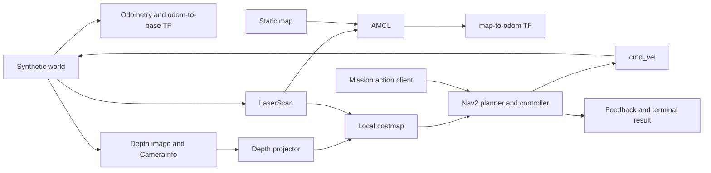

# AMR Edge Navigation Lab

An independent robotics portfolio demonstrating **ROS 2 Humble, Nav2, AMCL, depth projection, and navigation action lifecycle management** with synthetic sensors. No robot hardware is required.


This is a new portfolio implementation prepared with AI assistance. It contains no GM code, maps, measurements, or production data. Jetson Orin NX and ZED are integration targets; this repository does **not** claim hardware deployment, hardware performance, or a trained VLA policy.

## What runs

| Layer | Implemented behavior |
| --- | --- |
| Portable core | A* baseline, footprint inflation, no diagonal corner cutting, depth projection, mission-state rules |
| ROS simulator | Differential-drive kinematics, odometry/TF, laser ray casting, synthetic depth images, a toggleable obstacle |
| Perception | `32FC1` depth + CameraInfo to height-filtered PointCloud2; checks NaN, range, shape, row padding and byte order |
| Navigation | Nav2 planner/controller/costmaps and AMCL map localization; local costmap consumes scan + projected depth |
| Mission client | NavigateToPose goal, acceptance, distance feedback, timeout, cancellation and final result; lifecycle readiness check |
| Evidence | Unit tests, live ROS integration check, JSON/CSV results and a self-contained HTML replay |

## Start without ROS — Windows, Linux or macOS

Use Python 3.10+ from this repository directory. No third-party packages are needed:

```bash
python -m unittest discover -s tests -v
python -m amr_edge_lab.offline --scenario blocked --out artifacts/offline
```

Open `artifacts/offline/replay.html` in a browser. Other scenarios are `normal`, `canceled` and `unreachable`.

**The offline replay uses the small A* baseline, not Nav2.** It is useful for learning and unit tests. The following Docker route runs actual ROS 2/Nav2 nodes.

## Run ROS 2 / Nav2 in Ubuntu or WSL

Docker must already be installed and running. The container uses Ubuntu 22.04 + ROS 2 Humble even if the host is Ubuntu 24.04:

```bash
docker build -t amr-edge-nav-lab .
docker run --rm --init -it --name amr-lab amr-edge-nav-lab
```

In another terminal, submit a mission after Nav2 becomes active:

```bash
docker exec amr-lab /portfolio-entrypoint.sh ros2 service call /mission/start std_srvs/srv/Trigger '{}'
docker exec amr-lab /portfolio-entrypoint.sh ros2 topic echo /mission/status
```

Cancel a mission or add a synthetic obstacle:

```bash
docker exec amr-lab /portfolio-entrypoint.sh ros2 service call /mission/cancel std_srvs/srv/Trigger '{}'
docker exec amr-lab /portfolio-entrypoint.sh ros2 service call /demo/toggle_blocker std_srvs/srv/SetBool '{data: true}'
docker exec amr-lab /portfolio-entrypoint.sh ros2 service call /demo/toggle_blocker std_srvs/srv/SetBool '{data: false}'
```

The fixed blocker may or may not intersect the route chosen by the current planner. Inspect the path and costmaps instead of assuming every toggle must trigger a replan.

## Automated live integration check

```bash
docker run --rm --init amr-edge-nav-lab bash /ws/src/amr-edge-nav-lab/tools/ros_check.sh
```

For the full warehouse route with exported logs and replay on the host:

```bash
docker run --rm --init \
  -v "$PWD:/ws/src/amr-edge-nav-lab" \
  amr-edge-nav-lab bash /ws/src/amr-edge-nav-lab/tools/ros_check.sh --full
```

Inspect `artifacts/ros/smoke.json`, `trajectory.csv`, `launch.log` and `replay.html`. The check requires sensor data, `map -> base_link` TF, an active Nav2 navigator, a confirmed canceled action, and successful arrival at the next goal.

For a native **Ubuntu 22.04 / ROS 2 Humble** installation:

```bash
mkdir -p ~/amr_ws/src
git clone https://github.com/yilinw92/amr-edge-nav-lab.git ~/amr_ws/src/amr-edge-nav-lab
cd ~/amr_ws
source /opt/ros/humble/setup.bash
rosdep install --from-paths src --ignore-src -r -y
colcon build --symlink-install
source install/setup.bash
ros2 launch amr_edge_lab demo.launch.py
```

The bundled Nav2 configuration is for Humble; do not treat it as a drop-in Jazzy configuration.

## Architecture



## Learning and evidence

- [Chinese first lesson and learning path](docs/LEARN_CN.md)
- [Architecture, failure cases and interview questions](docs/INTERVIEW_CN.md)
- [Jetson / ZED integration boundaries](docs/JETSON_ZED.md)
- [Validation record](docs/VALIDATION.md)
- [Upstream references and licenses](THIRD_PARTY.md)

## Scope

The simulator uses ideal odometry and simplified extruded-wall depth. It does not model slip, noise, camera optics, exposure, network failures, dynamics, or a safety controller. The planner/controller/AMCL come from Nav2; this project contributes the simulator, depth adapter, mission client, tests and evidence exports. A* and Nav2 are different execution paths. No learned policy or VLA model is included.

Original project code is MIT licensed; the adapted Nav2 configuration retains its upstream license.
