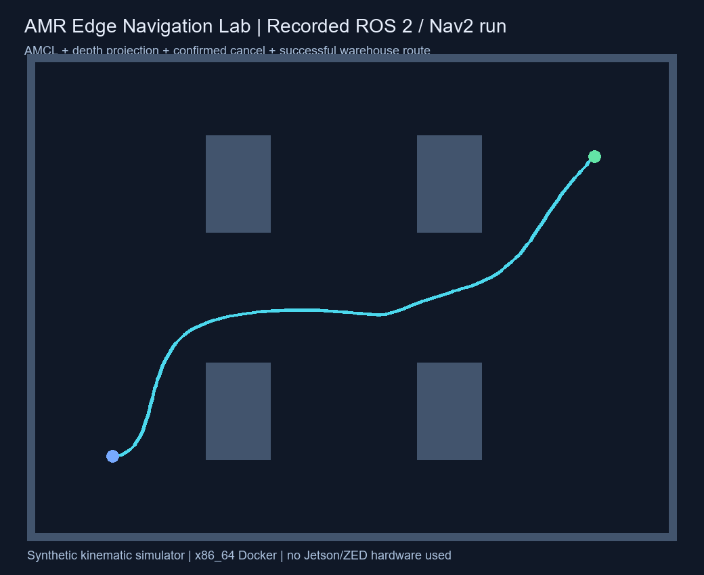
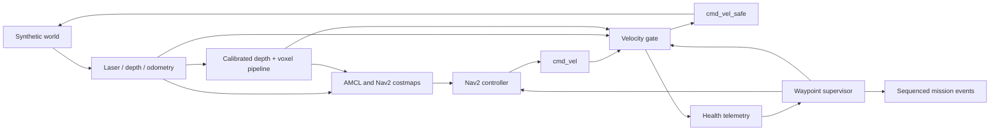

# AMR Edge Navigation Lab — fault-aware ROS 2 navigation

An independent **ROS 2 Humble / Nav2** portfolio focused on a practical failure: a navigation action can remain active after perception stops updating. This project combines calibrated depth processing, a final software velocity gate, and a waypoint supervisor that waits for confirmed cancellation before retrying.



The simulator and test data are synthetic. No GM source, maps or production measurements are included. Jetson Orin NX and ZED are hardware integration targets; this repository has been tested on x86 Docker/WSL, not those devices. No trained VLA model is claimed.

## Original engineering contributions

| Layer | Implemented behavior | Verification |
| --- | --- | --- |
| Depth processing | Byte order/row-padding checks, timestamp and CameraInfo consistency, optical-to-body transform plus mount RPY/translation, height/range gates, voxel centroids, connected-bin clustering | Portable and vectorized implementations compared on 20 seeded random inputs |
| Command arbitration | Scan/depth/odometry freshness, command and mission-heartbeat watchdogs, sampled swept-disc braking envelope, reverse-motion support | Stale data and nearby obstacles suppress both linear and angular commands |
| Route supervisor | Waypoint queue, acceptance/feedback/result, monotonic goal tokens, confirmed cancellation, cooldown, bounded retry/pause budgets, operator-cancel precedence, latched transport fault | Race, rejection, timeout, late-callback and missing-result tests |
| ROS integration | Synthetic differential drive, laser/depth/odometry/TF, AMCL and Nav2, sensor fault service, event/status topics | Live camera-dropout, two-waypoint recovery and operator-cancellation scenario |
| Evidence | Event journal, safety trace, JSON results, offline A* baseline and recorded ROS trajectories | CI runs portable tests and actual ROS integration; uploads evidence |

Nav2 supplies planning, control, costmaps and AMCL. This project does not present the upstream navigation algorithms as original work.

## Run the core and benchmark

```bash
python -m pip install -r requirements.txt
python -m unittest discover -s tests -v
python tools/benchmark_perception.py
python -m amr_edge_lab.offline --scenario blocked --out artifacts/offline
```

The portable tests and A* replay run without ROS. NumPy enables the vectorized processor and its differential test. The offline replay is explicitly a grid-planning baseline, **not a Nav2 execution**.

## Run actual ROS 2 / Nav2 — Ubuntu or WSL

```bash
docker build -t amr-edge-nav-lab .
docker run --rm --init -it --name amr-lab amr-edge-nav-lab
```

From another terminal:

```bash
docker exec amr-lab /portfolio-entrypoint.sh ros2 service call /mission/start_route std_srvs/srv/Trigger '{}'
docker exec amr-lab /portfolio-entrypoint.sh ros2 topic echo /mission/events
docker exec amr-lab /portfolio-entrypoint.sh ros2 topic echo /safety/status
```

Default route: `(1.85,1.05)` then `(1.85,2.85)` metres. `/mission/start` still submits the configurable single goal, default `(6.85,4.85)`. Override the flat `waypoints` XY array on the mission manager for another route. Requests are accepted only with active Nav2 and fresh sensor-health telemetry.

Inject a missing depth camera, then restore it:

```bash
docker exec amr-lab /portfolio-entrypoint.sh ros2 service call /demo/depth_enabled std_srvs/srv/SetBool '{data: false}'
docker exec amr-lab /portfolio-entrypoint.sh ros2 service call /demo/depth_enabled std_srvs/srv/SetBool '{data: true}'
docker exec amr-lab /portfolio-entrypoint.sh ros2 service call /mission/cancel std_srvs/srv/Trigger '{}'
```

Camera loss: gate outputs zero velocity → supervisor requests cancellation → final action result confirms settlement → route stays paused → healthy cooldown → same waypoint is resubmitted with a new token. Operator cancellation is terminal and never auto-resumes. Missing cancellation results latch `FAULT`; they do not authorize another goal.

## Reproduce the evidence

```bash
docker run --rm --init -v "$PWD:/ws/src/amr-edge-nav-lab" \
  amr-edge-nav-lab bash /ws/src/amr-edge-nav-lab/tools/ros_fault_check.sh
docker run --rm --init -v "$PWD:/ws/src/amr-edge-nav-lab" \
  amr-edge-nav-lab bash /ws/src/amr-edge-nav-lab/tools/ros_check.sh --full
```

Inspect `artifacts/ros/fault_summary.json`, `mission_events.jsonl`, `safety_trace.json`, `fault_launch.log`, and the navigation replay. The fault check requires the robot to be moving before disabling depth; measures time until a zero output; checks stationary hold; verifies terminal action events precede retry; completes two waypoints; then checks operator cancellation cannot resume. Host scheduling stalls can trigger additional safe pauses; these are counted, with a bounded recovery budget, rather than omitted from results.

Saved local evidence: [fault-injection result](docs/evidence/fault_summary.json), [mission journal](docs/evidence/mission_events.jsonl), [projection benchmark](docs/evidence/perception_benchmark.json). These are measurements of the stated synthetic setup, not industrial safety or Jetson latency guarantees.

## Dataflow



## Learning and scope

- [Chinese engineering guide, exercises and interview explanation](docs/ENGINEERING_CN.md)
- [Introductory lessons](docs/LEARN_CN.md)
- [Jetson / ZED integration notes](docs/JETSON_ZED.md)
- [Validation record](docs/VALIDATION.md)
- [Upstream references and licenses](THIRD_PARTY.md)

The simulator uses ideal wheel odometry, simplified extruded-wall depth and a synthetic planar scan. The gate is a **software demonstration**, not certified protective hardware: it assumes a circular footprint, static observed obstacles and a configured deceleration; it samples a constant-twist swept path and cannot model all real braking dynamics, coverage gaps or moving objects. Physical deployment needs calibrated sensor TF, measured timing/braking limits and a controller watchdog. Current sensor calibration is supplied as parameters; live TF extrinsic lookup, a ZED driver and real visual odometry are future hardware work. Original code is MIT licensed; the adapted Nav2 configuration retains its upstream license.
