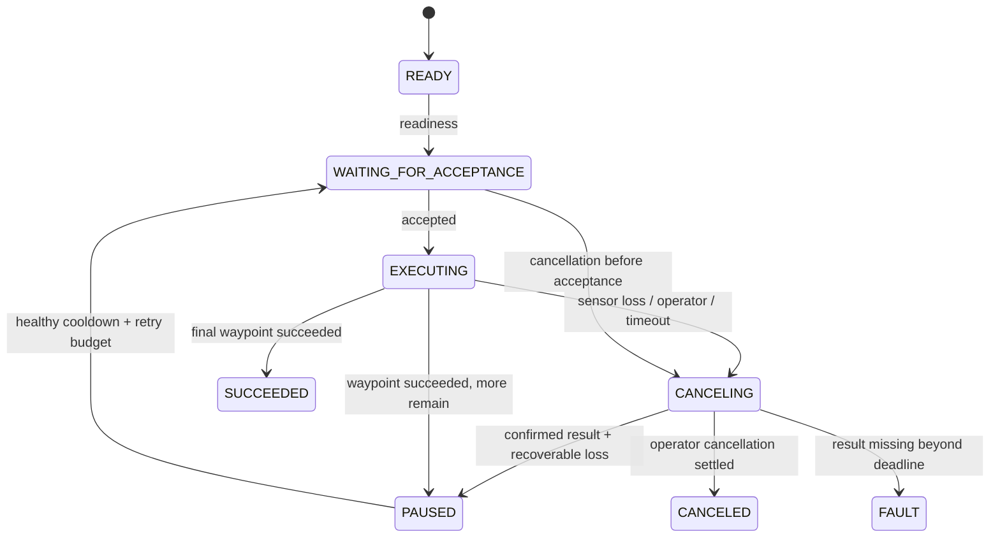

# AMR 项目的核心：失败时系统怎样继续保持可控

## 先能说清解决的问题

正常导航通常由 Nav2 完成。自己的工程价值在于：深度相机停更后，旧障碍图可能还在；发出取消请求不代表 action 已经结束；上一个目标的延迟回调不能改坏新任务状态；人工取消不能被自动恢复逻辑覆盖。本项目把这些问题拆成可独立测试的感知、速度门控和任务状态机，再用实际 ROS 进程验证整条链路。

## 第一天：运行一条完整故障链路

按 README 建 Docker 镜像，运行 `tools/ros_fault_check.sh`。它会在机器人已经移动后关闭深度数据，记录停车延迟和事件，再打开数据，完成两个航点，最后测试人工取消。

读 `fault_summary.json` 和 `mission_events.jsonl`，找出：

1. `CANCEL_REQUESTED`：为什么取消？
2. `CANCEL_REPLY`：服务端是否接受取消？
3. `GOAL_RESULT`：最终是否真的取消？
4. 新 `GOAL_SENT`：是否出现在最终结果之后？token 是否递增？
5. 最后一次人工取消后是否还出现新的目标？

不能拿“服务调用成功”的截图代替上述证据。发现宿主机调度造成额外传感器超时，也要保留计数和诊断；测试允许预算内的安全暂停，不允许无限重试或提前发送重叠目标。

## 感知：相机像素怎样成为机器人障碍点

光学坐标中 X 向右、Y 向下、Z 向前。像素 `(u,v)`、深度 `d`、内参 `fx,fy,cx,cy` 得到：

```text
X=(u-cx)*d/fx, Y=(v-cy)*d/fy, Z=d
基础车体坐标=(Z,-X,-Y)
最终点=Rz(yaw)*Ry(pitch)*Rx(roll)*基础车体坐标 + translation
```

代码分别检查编码/形状、行填充、字节序、时间戳、CameraInfo 的尺寸和 frame，再做有效距离、车体高度和体素过滤。体素质心可减少重复点；最少点数可以滤掉孤立噪点，也可能删掉细小障碍，所以不能只追求点越少越快。

`cluster_obstacles` 使用 XY 栅格的 8 邻接连通分量生成包围盒诊断。它不是语义识别、目标跟踪或 DBSCAN，不要混用这些名词。

读取顺序：`perception.py` → `perception_numpy.py` → `depth_node.py`。可移植实现作为可理解的对照，NumPy 实现批量投影、筛选、unique 分组和质心累加。20 组随机输入比较两者统计和点坐标。性能脚本同时报告后端、采样步长、体素尺寸、输出点数和输入规模。

## 速度门控：不要只依赖“取消任务后应该停”

```text
Nav2 /cmd_vel → safety_node → /cmd_vel_safe → 底盘／模拟器
```

只有 scan、depth、odom 都新鲜，命令没超时、任务心跳存在且没有 inhibit，门控才考虑放行。它按当前速度和配置减速度算预测时域 `reaction + abs(v)/deceleration`，沿恒定 twist 路径采样圆形 footprint；观察点进入 margin 则输出零线速度和零角速度。恒定初速预测对静态障碍比沿路减速更保守，离散采样还留了额外余量。反向行驶同样检查。

需要理解它的范围：圆形 footprint 转动不改变包络；非圆底盘、移动障碍、相机盲区和实际刹车能力不在这个模型内。0.5 秒传感器窗口是演示参数，实机要用速度、视距、网络延迟和刹车距离确定，不能照抄。

模拟器只订阅门控后的 topic，避免 Nav2 绕过保护。若 gate 进程失效，模拟器还有命令超时停车；实际底盘也需要独立 watchdog。

## 状态机：异步系统的难点在边界



状态逻辑在 `supervisor.py`，ROS futures 在 `route_node.py`。每次发送目标分配递增 token，回调先核对 token，过期回调只能记日志。人工取消优先于恢复；缺失取消终态进入 FAULT 并保持速度 inhibit。失败重试和感知暂停分别有限额。

journal 记录 seq、单调时间、route_id、waypoint、token、event、reason。它用于追踪本次运行，尚未实现进程重启后的持久化恢复。这里“event-sourced”指有序事件记录和可验证顺序，不表示具备完整分布式事件存储系统。

## 两周学习路线：每一步都要亲手改

| 阶段 | 动手内容 | 应交出的证据 |
| --- | --- | --- |
| 1–2 天 | 跑故障测试，按事件顺序复述恢复流程 | 标注过的 journal；自己的 2 分钟讲解 |
| 3–4 天 | 改相机 pitch，手算一个像素到车体坐标 | 手算与单测一致；解释为何地面过滤随姿态变化 |
| 5–6 天 | 比较 stride=1/2/4、体素大小和最少点数 | 同一环境的 CSV/JSON；指出速度与小障碍保留的取舍 |
| 7–8 天 | 增加一种新的失败原因，并明确是否可恢复 | 状态测试：取消前后、重试限额、人工取消优先级 |
| 9–10 天 | 在模拟器增加 odometry 停更服务 | 实跑证明另一传感器故障也停止输出，恢复有序 |
| 11–12 天 | 增加 route 配置和异常输入校验 | 空队列、奇数 XY、NaN、重复启动都被合理拒绝 |
| 13–14 天 | 录演示，独立解释模块边界和局限 | 测试 → 故障 → 事件 → 恢复 → 自己修改的代码 |

练习答案提示：如果收到“取消被接受”就把状态改成 CANCELED，测试应该能构造服务回复之后、最终 result 之前收到另一个 start 的情况，并拒绝它。若结果恰好 succeeded，必须记录真实服务端结果，同时尊重人工“不要再继续下一航点”的意图。

## 可以使用的面试介绍

> I built a fault-aware ROS 2 navigation portfolio around Nav2. My contribution is a calibrated depth pipeline, a final velocity gate and a waypoint supervisor with bounded recovery. The gate rejects stale sensor data independently of the action client, while the supervisor waits for a confirmed terminal result before retrying the waypoint. I used monotonic goal tokens to prevent delayed callbacks from corrupting a newer mission. I compared vectorized perception with a portable reference implementation and tested a live camera dropout, recovery and explicit operator cancellation in Docker.

**为什么需要两层停车逻辑？** 门控在数据过期时直接压制命令，action 取消则负责让规划/控制任务结束，避免后续错误继续执行。两者承担不同职责，还需要底盘 watchdog。

**你自己写了哪些导航算法？** 生产导航链路使用 Nav2。自己的主要代码是感知适配、软件门控、任务监督、模拟器和验证；另有独立 A* 基线。这个边界必须清楚。

**Jetson / ZED 怎么接？** 使用真实 driver 和深度/CameraInfo topic，确认 32FC1 米制、timestamp、QoS 和外参，测量实际端到端耗时，确认容器与 JetPack/SDK 兼容。本仓库目前用参数外参，尚未实机验证；合成 scan 也不能直接当作 ZED 真实激光雷达。

**VLA 在哪里？** 当前没有训练的 VLA。可扩展任务层，让语言或视觉输出结构化目标并经过约束检查，但这不等于端到端视觉语言动作策略。先把已经可运行的工程证据讲透。

参考：[ROS 2 action client 的异步 goal/result 流程](https://docs.ros.org/en/humble/Tutorials/Intermediate/Writing-an-Action-Server-Client/Py.html)。
